# ESP8266 RJ45 Sensor Board

An ESP8266-powered sensor hub with **five RJ45 ports**. Plug in **DS18B20** temperature probes, **SHT3x / SHT4x / AHT20 / BME280 / BMP280** temperature-humidity-pressure sensors or a **MAX6675** thermocouple, and the board finds them on its own. No code changes, no recompiling. Your sensors connect with plain network cables, so they can live in the next room, in the greenhouse, or inside the beehive. The bees get the cables, you get the couch.

<p align="center">
  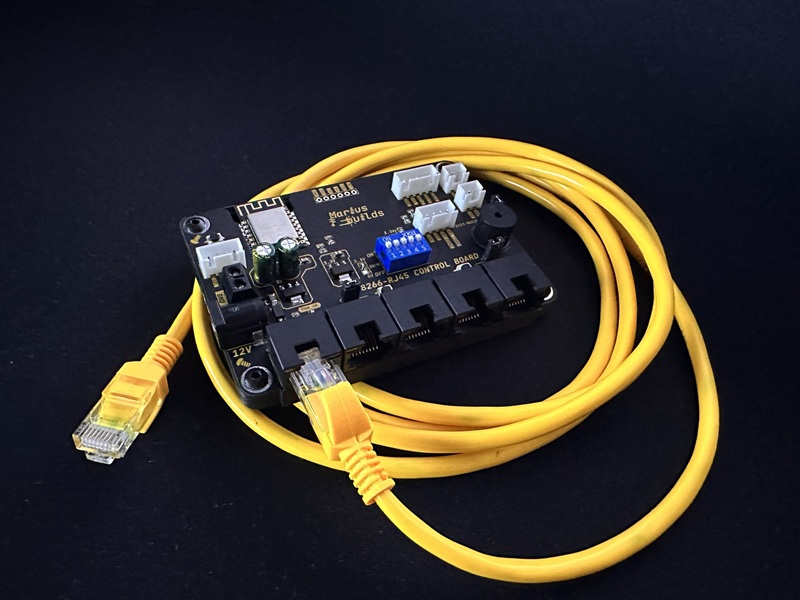
</p>

Why RJ45? Because Ethernet cables are cheap, sturdy, come in every length imaginable, and you probably already have a drawer full of them. Finally, a use for that drawer.

## MAIN FEATURES :

- **ESP-12F (ESP8266)** – Wi-Fi built in, so the board knows what time it is (NTP), runs its own web dashboard and can send your temperatures wherever you want.
- **5x RJ45 ports** with built-in port LEDs: all five carry the 1-Wire bus for DS18B20s, **RJ3 / RJ4** add I2C, **RJ5** adds SPI and **RJ1** brings out spare GPIOs. [Full pinout below](#rj45-port-pinout).
- **Plug & play sensors** (firmware 5.0) – DS18B20, SHT30/31/35, SHT40/41/45, AHT20/21, BME280, BMP280 and MAX6675 are detected automatically and appear on the display and the web page within 30 seconds.
- **I2C connector** for sensors and the OLED display, plus **SPI**, 2-pin and 4-pin XH headers and a 6-pin programming header.
- **1.3" SH1106 OLED** (128x64, I2C) with a full menu: overview, per-sensor screens with min/max, humidity, dew point, pressure and trend arrows, alarms, settings and info.
- **Two buttons (A / B)** for navigating the menu, each with an enable jumper (IO12 / IO14) so you can free up the pins if you need them for something else.
- **Buzzer** on IO13, for key beeps, a startup sound and temperature alarms.
- **5-position DIP switch** to power each port on or off, and a **3.3V / 5V selection solder jumper** for the sensor side.
- **12V input** through a DC jack or a screw terminal, with reverse-polarity diodes and a resettable fuse.
- **AMS1117-5.0 + AMS1117-3.3** regulators, so everything gets the voltage it likes.
- **3D-printable case** with a display window, button and port labels.

<p align="center">
  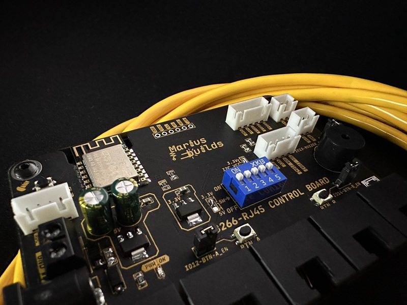
  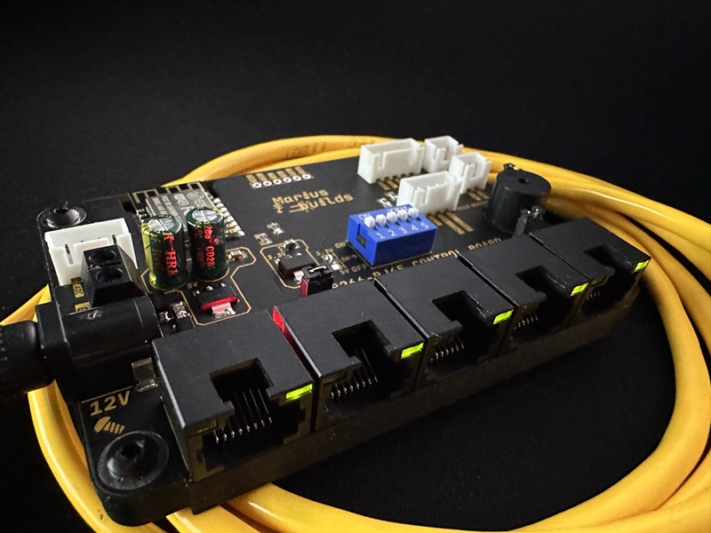
</p>

## IMPORTANT INFORMATIONS ! 

1. **Power it from 12V** (DC jack or screw terminal). The onboard regulators take it from there. The 5V regulator is a linear AMS1117, so it gets warm from 12V; that's normal, it just means it's working hard so you don't have to.

2. **There's no USB on this board.** To flash the ESP-12F you need a **USB-to-serial adapter** on the 6-pin programming header. A great match: my [USB-C CH340K Auto-Reset Programmer](https://github.com/mariusmym/USB-C-CH340K-Auto-Reset-Programmer).

3. **GPIO0 is also the 1-Wire bus** for the DS18B20 sensors. GPIO0 decides whether the ESP boots normally or enters flashing mode, so **if uploading fails, unplug the RJ45 sensors** and try again.

4. **Switch the port on.** Each port gets its power from its own DIP switch (SW2), and the port's 4.7k 1-Wire pull-up hangs on that same supply. A port with its switch off has no power and no pull-up. The port LED tells you which ones are on.

5. **Use 3.3V for I2C and SPI sensors** (solder jumper JP1). Most sensor breakout boards pull their data lines up to their own supply, and at 5V that means 5V on the ESP's pins. DS18B20s are perfectly happy at 3.3V too, so 3.3V is the safe choice for everything.

6. **Sensors are numbered in the order they're found, not by port.** All DS18B20s share one bus, so "DS #1" is simply the first one the board met. Each sensor keeps its slot, so give it a proper name on the web page (Sensors → label) the first time and you're done. Future you will be grateful.

7. **Put your own Wi-Fi name and password** in `secrets.h` (`YOUR_WIFI_SSID` / `YOUR_WIFI_PASS`) before uploading. They live in a separate file so you can share the sketch without sharing your Wi-Fi with the whole internet.

## RJ45 port pinout

All five ports share pins **2 (1-Wire)**, **4 (VCC)** and **8 (GND)**, so a DS18B20 works in any of them. The other pins are what makes each port different.

| Pin | T568B wire | RJ1 | RJ2 | RJ3 | RJ4 | RJ5 |
|:---:|---|---|---|---|---|---|
| 1 | white/orange | ADC | – | – | – | – |
| 2 | orange | **IO0 · 1-Wire** | **IO0 · 1-Wire** | **IO0 · 1-Wire** | **IO0 · 1-Wire** | **IO0 · 1-Wire** |
| 3 | white/green | IO16 | – | – | – | – |
| 4 | blue | VCC-RJ1 | VCC-RJ2 | VCC-RJ3 | VCC-RJ4 | VCC-RJ5 |
| 5 | white/blue | IO12 | – | **IO5 · SCL** | **IO5 · SCL** | **IO14 · SCK** |
| 6 | green | – | – | **IO4 · SDA** | **IO4 · SDA** | **IO13 · SO** |
| 7 | white/brown | IO2 | – | – | – | **IO15 · CS** |
| 8 | brown | GND | GND | GND | GND | GND |
| | **use it for** | DS18B20, GPIO | DS18B20 | I2C + DS18B20 | I2C + DS18B20 | MAX6675 + DS18B20 |

The wire colours are **T568B**, the standard almost every patch cable uses. A straight cable keeps the pin numbers end to end, so the colours only matter where you wire the sensor: to an RJ45 plug, a keystone jack or the far end of a cut cable.

**How the ports are powered:** solder jumper **JP1** picks **3.3V or 5V** for all ports, then DIP switch **SW2** (one switch per port) connects it to VCC-RJ1 … VCC-RJ5. The port LED (jack pins 9 / 10, with a 1k resistor) lights when the port has power.

### RJ1 · GPIO + 1-Wire

<p align="center">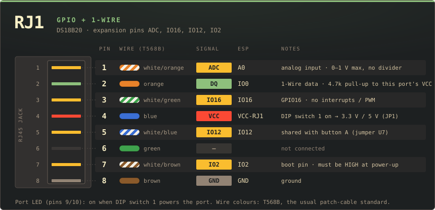</p>

| Pin | Wire | Signal | ESP8266 | Notes |
|:---:|---|---|---|---|
| 1 | white/orange | ADC | A0 | Analog input, **0 – 1 V max** (no divider on the board) |
| 2 | orange | DQ | IO0 | 1-Wire data, 4.7k pull-up (R2) to VCC-RJ1 |
| 3 | white/green | IO16 | IO16 | Plain GPIO (no interrupts, no PWM) |
| 4 | blue | VCC | VCC-RJ1 | DIP switch 1 |
| 5 | white/blue | IO12 | IO12 | **Shared with button A** (remove jumper U7 to use it here) |
| 6 | green | – | – | not connected |
| 7 | white/brown | IO2 | IO2 | Boot pin: must be HIGH at power-up, don't pull it low |
| 8 | brown | GND | GND | |

RJ1 is the expansion port. Firmware 5.0 only uses its 1-Wire pin; ADC, IO16 and IO2 are free for your own ideas.

### RJ2 · 1-Wire

<p align="center">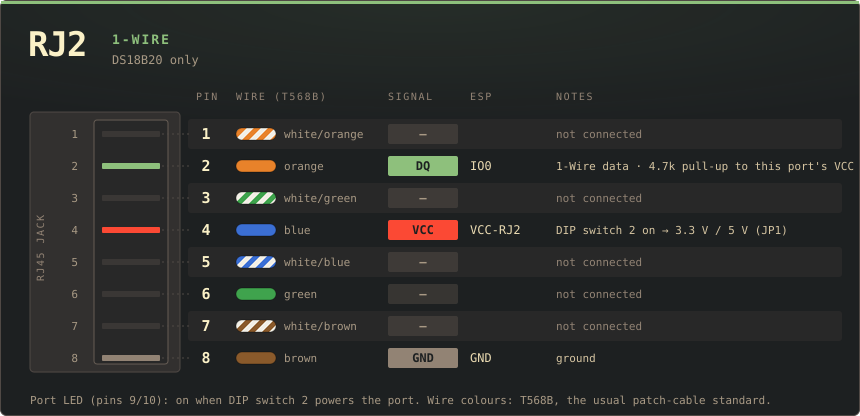</p>

| Pin | Wire | Signal | ESP8266 | Notes |
|:---:|---|---|---|---|
| 2 | orange | DQ | IO0 | 1-Wire data, 4.7k pull-up (R14) to VCC-RJ2 |
| 4 | blue | VCC | VCC-RJ2 | DIP switch 2 |
| 8 | brown | GND | GND | |
| 1, 3, 5, 6, 7 | | – | – | not connected |

### RJ3 · I2C + 1-Wire

<p align="center">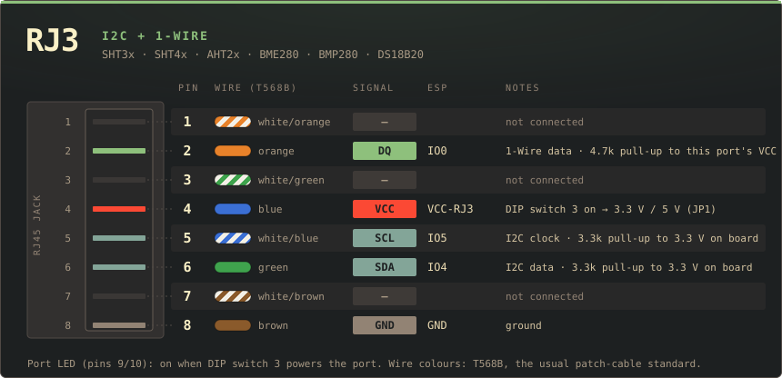</p>

| Pin | Wire | Signal | ESP8266 | Notes |
|:---:|---|---|---|---|
| 2 | orange | DQ | IO0 | 1-Wire data, 4.7k pull-up (R15) to VCC-RJ3 |
| 4 | blue | VCC | VCC-RJ3 | DIP switch 3 |
| 5 | white/blue | SCL | IO5 | I2C clock, 3.3k pull-up (R8) to 3.3V on the board |
| 6 | green | SDA | IO4 | I2C data, 3.3k pull-up (R7) to 3.3V on the board |
| 8 | brown | GND | GND | |
| 1, 3, 7 | | – | – | not connected |

### RJ4 · I2C + 1-Wire

<p align="center">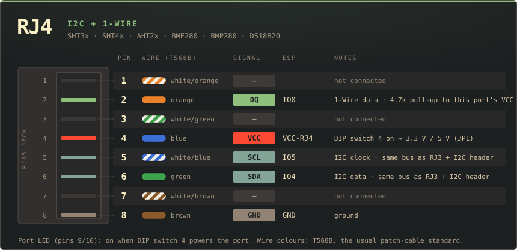</p>

| Pin | Wire | Signal | ESP8266 | Notes |
|:---:|---|---|---|---|
| 2 | orange | DQ | IO0 | 1-Wire data, 4.7k pull-up (R16) to VCC-RJ4 |
| 4 | blue | VCC | VCC-RJ4 | DIP switch 4 |
| 5 | white/blue | SCL | IO5 | Same I2C bus as RJ3, the I2C header and the OLED |
| 6 | green | SDA | IO4 | Same I2C bus as RJ3, the I2C header and the OLED |
| 8 | brown | GND | GND | |
| 1, 3, 7 | | – | – | not connected |

RJ3, RJ4, the I2C header and the OLED are **one bus**. Two sensors of the same type need different addresses: an SHT31 at 0x44 and another at 0x45 is fine, two at 0x44 is not.

### RJ5 · SPI + 1-Wire

<p align="center">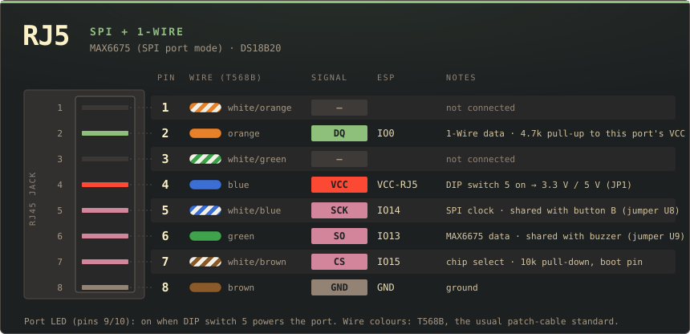</p>

| Pin | Wire | Signal | ESP8266 | Notes |
|:---:|---|---|---|---|
| 2 | orange | DQ | IO0 | 1-Wire data, 4.7k pull-up (R17) to VCC-RJ5 |
| 4 | blue | VCC | VCC-RJ5 | DIP switch 5 |
| 5 | white/blue | SCK | IO14 | SPI clock, **shared with button B** (jumper U8) |
| 6 | green | SO | IO13 | MAX6675 data out, **shared with the buzzer** (jumper U9) |
| 7 | white/brown | CS | IO15 | Chip select, 10k pull-down (R6). Boot pin: must be LOW at power-up |
| 8 | brown | GND | GND | |
| 1, 3 | | – | – | not connected |

The SPI pins only work in **SPI port mode** (see [SPI port mode](#spi-port-mode-max6675)).

### Wiring examples

| Sensor | Port | Pin 2 | Pin 4 | Pin 5 | Pin 6 | Pin 7 | Pin 8 |
|---|---|---|---|---|---|---|---|
| **DS18B20** probe | any | data (yellow) | VCC (red) | | | | GND (black) |
| **SHT3x / SHT4x / AHT20 / BME280** breakout | RJ3, RJ4 | | VIN | SCL | SDA | | GND |
| **MAX6675** module | RJ5 | | VCC | SCK | SO | CS | GND |

A port can carry two things at once: an I2C sensor on pins 5 / 6 and a DS18B20 on pin 2 of the same cable work fine together.

### Other connectors

| Connector | Pin 1 | Pin 2 | Pin 3 | Pin 4 | Pin 5 | Pin 6 |
|---|---|---|---|---|---|---|
| **I2C** (XH 4-pin) | GND | VCC (3.3V / 5V, solder jumper JP2) | IO4 · SDA | IO5 · SCL | | |
| **SPI** (XH 5-pin) | GND | **+5V** | IO15 · CS | IO13 · SO | IO14 · SCK | |
| **CN2** (XH 4-pin) | ADC | IO16 | IO12 | IO2 | | |
| **CN1** (XH 2-pin) | +5V | GND | | | | |
| **CN3** (XH 2-pin) | +3.3V | GND | | | | |
| **H1** programming | GND | +3.3V | TX | RX | IO0 | RST |

The **SPI header's VCC is fixed at 5V**. A MAX6675 module powered from 5V drives its data line at 5V, so if you use the SPI header, power the module from 3.3V instead (CN3), or simply use RJ5 with JP1 on 3.3V.

## The firmware 
 
The sketch in **SKETCH/RJ45_Board_V5_0** (**v5.0**) turns the board into a proper little sensor station:

- **Plug & play sensors** – the board looks for new sensors every 30 seconds. Whatever it finds gets a slot and shows up on the OLED and the web page, no code changes needed.
- **8 sensor slots, remembered by identity** – a DS18B20 by its unique ROM address, an I2C sensor by chip type + address. Each one keeps its slot, label, calibration offset and alarm when other sensors come and go. A sensor that disappears stays listed as **LOST** until you click **Forget** on the web page.
- **Temperature, humidity, dew point and pressure**, whichever the sensor has.
- **Non-blocking readings** – the buttons respond instantly, even while the sensors are busy.
- **Min / max and a trend arrow** for every sensor (the arrow shows up when the temperature moves more than 0.2 °C per minute).
- **Temperature alarms** for each sensor: HIGH and LOW limits, plus a "sensor lost" alarm when a cable gets unplugged (or chewed). The display wakes up, the buzzer goes beep-beep-beep, and any button silences it. The alarm re-arms on its own once the temperature is back to normal (with 0.5 °C hysteresis, so it doesn't nag you about every tenth of a degree).
- **Calibration offset** per sensor. For humidity sensors the RH is recalculated at the corrected temperature, so the dew point stays right.
- **Long-term log in flash** – a 10-minute average of every value, kept for 7 – 14 days and downloadable as CSV.
- **Settings and alarms are saved in flash**, so they survive a power cut.
- **Automatic clock** – the time syncs over Wi-Fi with automatic summer/winter time. It's set for Romania; change `TZ_INFO` in the sketch for your time zone.
- **Screen-off timer**, adjustable contrast, and a big check mark every time you save something. Everyone deserves a little validation.

### Supported sensors

| Sensor | Measures | Bus / address | Plug it into |
|---|---|---|---|
| **DS18B20** (as many as you like) | temperature | 1-Wire | any port **RJ1 – RJ5** |
| **SHT30 / SHT31 / SHT35** | temperature, humidity | I2C 0x44 / 0x45 | **RJ3, RJ4**, I2C header |
| **SHT40 / SHT41 / SHT45** | temperature, humidity | I2C 0x44 / 0x45 | **RJ3, RJ4**, I2C header |
| **AHT20 / AHT21** | temperature, humidity | I2C 0x38 | **RJ3, RJ4**, I2C header |
| **BME280** | temperature, humidity, pressure | I2C 0x76 / 0x77 | **RJ3, RJ4**, I2C header |
| **BMP280** | temperature, pressure | I2C 0x76 / 0x77 | **RJ3, RJ4**, I2C header |
| **MAX6675** K-type thermocouple (0 – 1024 °C) | temperature | SPI | **RJ5**, SPI header (SPI port mode) |

The board has 8 sensor slots in total. Each I2C chip is identified properly (a chip ID, or a reply with a valid checksum), so the board never mistakes an SHT40 for an SHT31 even though they share an address. Everything answering on the I2C bus is listed in the web page footer, so even an unsupported chip at least shows it's alive.

### Menu
 
| Menu item | What it shows |
|---|---|
| **Overview** | Every sensor on one screen (4 per page, pages flip every 3 s); sensors in alarm blink |
| **One item per sensor** | Big temperature, trend arrow, min / max, plus humidity and dew point or pressure when the sensor has them |
| **Alarms** | Per sensor: alarm ON/OFF, HIGH limit, LOW limit |
| **Settings** | Key beep, alarm sound, screen off (never / 1 / 5 / 15 / 30 min), contrast |
| **Info** | IP address, Wi-Fi signal and channel, uptime, NTP status, sensors online, firmware version, port mode, 1-Wire power mode and total read errors |
 
### Controls
 
**A** is the left button, **B** is the right one. Tap = short press, hold = long press.
 
| Where | A | B |
|---|---|---|
| **Menu** | tap: next item · hold: previous | tap: open |
| **Viewing a screen** | tap: next screen · hold: previous | tap: back to menu · hold: reset min/max (on Overview: all sensors) |
| **Alarms / Settings** | tap: + / toggle · hold: − (repeats, speeds up after ~2 s) | tap: next field · hold: **SAVE** & exit |
| **Alarm ringing** | any button: acknowledge | any button: acknowledge |
| **Screen off** | any button wakes it up | any button wakes it up |
| **SPI port mode** | tap: next screen · hold: previous · any press acknowledges an alarm | (not available) |
 
Leave an edit screen alone for 60 seconds and it exits without saving. The readings are also printed to the serial monitor (115200 baud) every 10 seconds.

### Web dashboard

<p align="center">
  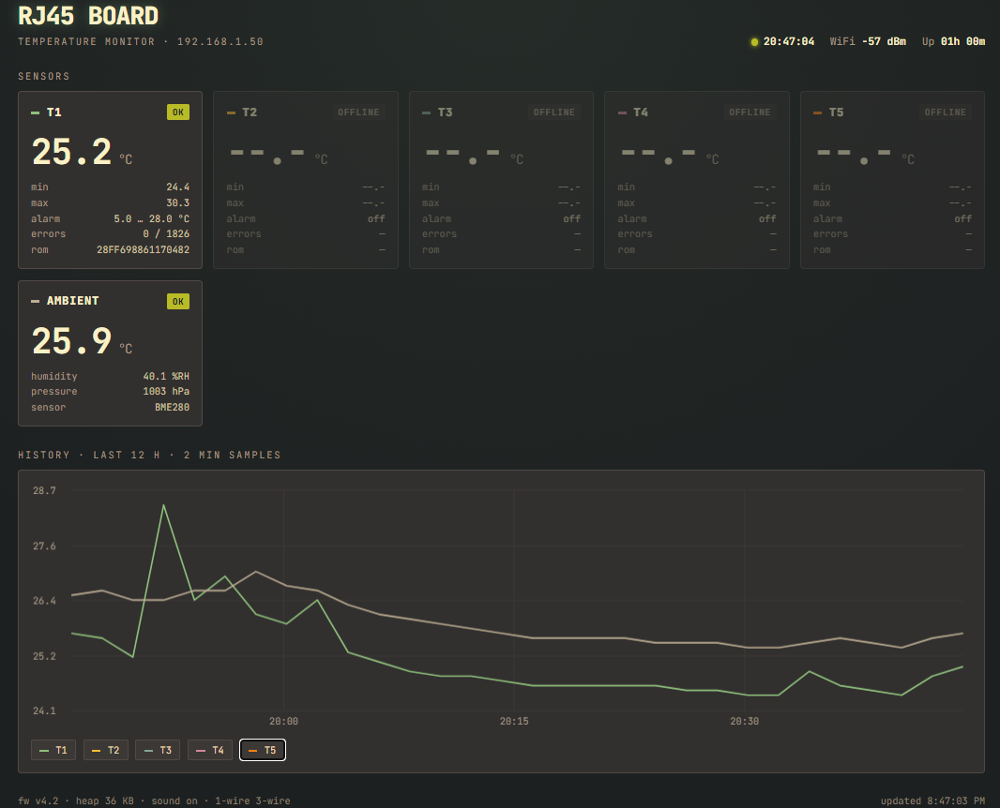
</p>
 
The board runs its own web page on your local network. Open **`http://192.168.1.50`** (or whatever IP you set) or **`http://rj45-board.local`** in any browser, on your PC or your phone:
 
- **Live sensor cards**, refreshed every 2 seconds: temperature, humidity, dew point, pressure, min / max, trend, alarm limits, error counters and where the sensor is connected.
- **Alarm banner** with a **Silence** button, so you can shut the buzzer up from the couch. The browser tab title also shows ⚠ ALARM.
- **12-hour history chart** (one point every 2 minutes). Click a sensor in the legend to hide or show its line.
- **Two CSV downloads**: the last 12 hours from RAM, and the long-term flash log (10-minute averages, 7 – 14 days, with humidity and pressure columns). On a browser set to a comma-decimal language (Romanian, for example) the files use `;` and decimal commas, so Excel opens them straight into columns.
- **Alarms** panel: ON/OFF and limits for every sensor.
- **Sensors** panel: a label for each sensor (shown on the OLED too), its calibration offset, and **Forget** for sensors that are gone.
- **Device** panel: alarm sound, key beep, screen-off time, contrast and the IO13 / IO14 port mode.
- **No internet needed.** The page is stored in the ESP's flash, with no external libraries or CDNs, so it works even on a network with no internet connection.
- **Gruvbox dark theme with monospace fonts**, because a temperature monitor should look like it means business.

**Setting up the address** – in `secrets.h`:
 
```cpp
#define USE_STATIC_IP
#define STATIC_IP    192, 168, 1, 50   // pick a free address in your network
#define STATIC_GW    192, 168, 1, 1    // your router
#define STATIC_MASK  255, 255, 255, 0
#define STATIC_DNS   192, 168, 1, 1    // usually the router; needed for NTP
#define MDNS_NAME "rj45-board"
```
 
The fixed IP has to be in your router's subnet and **outside its DHCP range**, otherwise the router may hand the same address to your neighbour's... sorry, your own phone. Check your network with `ipconfig` (Windows) or `ip a` (Linux/macOS). If you'd rather let the router decide, comment out `USE_STATIC_IP` and use `http://rj45-board.local`.
 
**JSON API**, for Home Assistant, Node-RED, or your own scripts:
 
| Endpoint | What it does |
|---|---|
| `GET /api/data` | Current readings, alarms, min/max, trend, sensor details, I2C bus scan, Wi-Fi, uptime |
| `GET /api/history` | The last 12 h of temperatures (tenths of a degree, 2 min apart) |
| `GET /api/log.csv` | The flash log as CSV (`?eu=1` for `;` and decimal commas) |
| `POST /api/ack` | Silences the active alarms |
| `POST /api/config` | `ch`, and any of `label`, `off`, `on`, `lo`, `hi` – label, offset and alarm of one sensor |
| `POST /api/forget` | `ch` – frees the slot of a sensor that is no longer connected |
| `POST /api/device` | any of `sound`, `beep`, `off`, `contrast`, `spi` – device settings |

### SPI port mode (MAX6675)

IO13 and IO14 do two jobs: they're the buzzer and button B, and they're also the SPI lines on RJ5 and the SPI header. The firmware can't safely guess which one you've wired, so you pick it once on the web page, under **Device → IO13 / IO14**:

| Mode | Jumpers | What you get |
|---|---|---|
| **Button B + buzzer** (default) | **U8** and **U9** on | Both buttons, beeps and alarm sound. SPI port unused. |
| **SPI port: MAX6675** | **U8** and **U9** removed | MAX6675 on RJ5 / the SPI header. Button A cycles the screens and silences alarms; alarms, labels and settings are set from the web page. No buzzer. |

The board restarts when you change the mode. If you forget to remove U9, the buzzer holds the data line low; the board then refuses to add the thermocouple and says so in the serial monitor.

### Sturdier sensor readings
 
- **Every DS18B20 reading is retried up to 3 times**, and any sensor is only marked as an error after **3 failed readings in a row**. Meanwhile it keeps showing the last good value, so one bad bit on a long cable doesn't set off the "sensor lost" alarm.
- **A missed bus search never drops a sensor.** Known DS18B20s are read by their ROM address whether the 30-second search saw them or not; only failed readings count.
- **The famous 85.0 °C glitch** (the value a DS18B20 reports right after power-on) is only rejected when it's a sudden jump, so a sensor that really is at 85 °C still gets believed.
- **I2C sensors are checked with their own CRC**, and read at a gentle 50 kHz to help longer cables. One that stops answering is looked for again every 30 seconds and comes back to its old slot.
- **Diagnostics** – every sensor counts its reads, errors and dropouts and remembers its last bad value. You'll find them on the web cards, the OLED **Info** screen and in the serial monitor.
- **Parasite-power detection** – the board tells you if any DS18B20 is running in 2-wire (parasite) mode.

### Sensor troubleshooting 
 
| You see | What it means | What to check |
|---|---|---|
| Last bad value **-127** | A DS18B20 didn't answer, or its data failed the CRC check | Wiring, a loose RJ45 plug, the port's DIP switch, a very long or poor-quality cable |
| Last bad value **85** | A DS18B20 powered up but never finished a measurement | Power to the sensor, or it's running in parasite mode (use 3 wires: VCC, GND, DATA) |
| **PARA** on the Info screen | At least one DS18B20 is in parasite (2-wire) mode | Connect the sensor's VCC wire; parasite mode and long cables don't get along |
| An I2C sensor never appears | It doesn't answer, or the firmware doesn't recognise it | Look at the I2C list in the web page footer. Its address missing = wiring or power (SDA and SCL swapped? port switched on?). Its address listed with a `?` = it answers but isn't recognised |
| The OLED glitches with an I2C cable plugged in | The cable is too long for the display's 400 kHz | Set `OLED_I2C_HZ` to `100000` in the sketch, or use a shorter cable |
| MAX6675 shows **TC open** | The chip answers but the thermocouple isn't connected | The thermocouple's two screws on the module |
| MAX6675 never appears | SPI port mode is off, or the data line is held | Device → IO13 / IO14 set to SPI; jumpers U8 / U9 removed |

### Adding another sensor type

Each chip is one small header in `SKETCH/RJ45_Board_V5_0/src/sensors/` with four functions: `detect()` (is this chip here?), `begin()`, `trigger()` (start a measurement) and `fetch()` (read the result 2 seconds later, so nothing ever blocks the buttons). To add one:

1. Add a line to the `KINDS` table in `SensorCore.h` (name, what it measures, its range).
2. Write the header; `SHT3x.h` is about 40 lines and a good starting point.
3. Add it to `identifyI2c()` in `Sensors.h`.

### Libraries

Install these from the Arduino Library Manager:

- **U8g2** (OLED)
- **OneWire** and **DallasTemperature** (DS18B20)

That's all. The SHT, AHT, BME/BMP and MAX6675 drivers are built into the sketch (`src/sensors/`), and the time comes from the ESP8266's built-in SNTP.

**Arduino IDE settings:**

- Board: **Generic ESP8266 Module** (ESP8266 board package)
- Flash Size: **4MB (FS:2MB OTA:~1019KB)** – the log needs the filesystem. With a Flash Size without FS everything works except the long-term log.

Firmware **4.2** (`SKETCH/RJ45_Board_A_B_ButtonsV4_2`) is still there if you need it; it also needs **Adafruit SHT31**, **Adafruit BME280**, **Adafruit Unified Sensor** and **Adafruit BusIO**.

### GPIO pinout

| Function | GPIO |
|---|---|
| 1-Wire bus (all ports, pin 2) | 0 |
| I2C (OLED, RJ3, RJ4, I2C header) | SDA 4 / SCL 5 |
| Button A (jumper U7) | 12 |
| Button B (jumper U8) / SPI SCK | 14 |
| Buzzer (jumper U9) / SPI SO | 13 |
| SPI CS | 15 |
| Spare on RJ1 / CN2 | ADC, 16, 2 |

### Firmware history

| Version | What changed |
|---|---|
| **5.0** | Plug & play sensors (DS18B20, SHT3x, SHT4x, AHT2x, BME280, BMP280, MAX6675), 8 sensor slots, humidity / dew point / pressure everywhere, calibration offsets, 10-minute flash log with CSV export, SPI port mode, Device panel, built-in sensor drivers |
| **4.2** | Web dashboard, JSON API, fixed IP + mDNS, 12 h history chart, sturdier DS18B20 readings and diagnostics |

### Make it yours 

Want MQTT, Home Assistant, or a push notification when the greenhouse gets too cold? Get your hands "dirty" and do it yourself ! :)

## Main components 

| Part | Component | LCSC |
|---|---|---|
| MCU | ESP-12F (ESP8266) | C89297 |
| RJ45 jacks (x5) | RCH RC02115 | C708657 |
| 5V regulator | AMS1117-5.0 | C6187 |
| 3.3V regulator | AMS1117-3.3 | C2688239 |
| Resettable fuse | Bourns MF-NSMF050-2 | C75464 |
| DIP switch | XKB DS-05BLP | C692503 |
| DC jack | XKB DC-005I-5A-2.5 | C2689704 |
| Screw terminal | KF301-5.0-2P | C474881 |
| Buttons (A, B, Reset) | ST-1188 | C589212 |

Full BOM in the **GERBER, BOM, PNP** folder.

**Not on LCSC, you'll need:**
- **DS18B20 sensors** (the waterproof probe version is perfect), wired to RJ45 plugs or keystone jacks
- **1.3" SH1106 I2C OLED** (128x64)
- **Optional:** SHT3x / SHT4x / AHT20 / BME280 / BMP280 I2C sensors, a MAX6675 module with a K-type thermocouple
- A **12V power supply** and some **Ethernet cables** (check the drawer)

## 3D-printable case 

The case is on Printables: https://www.printables.com/model/1869994-esp8266-rj45-sensor-board-case

It has a window for the display, labels for the A / B buttons, numbers for the five ports, and holes for the buzzer, so it can beep at you without being muffled.

<p align="center">
  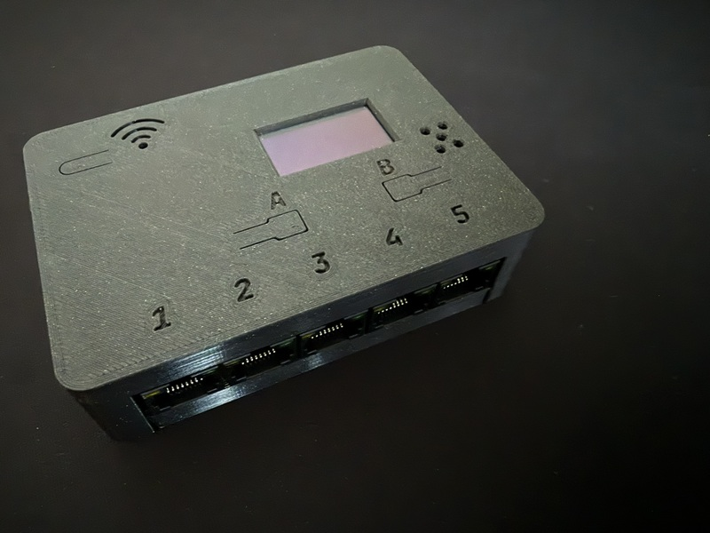
  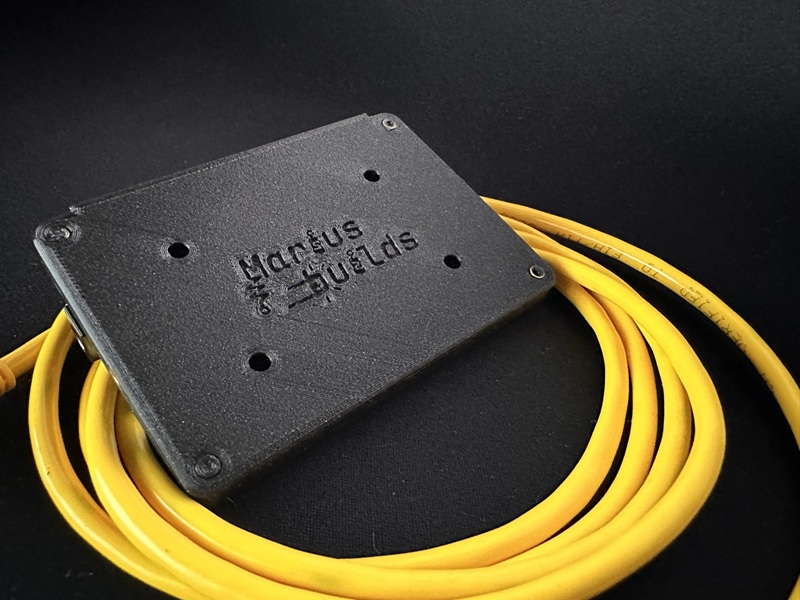
</p>

## Repository content 

- **GERBER, BOM, PNP** – everything needed to order the PCB from JLCPCB or your favorite fab.
- **SCHEMATIC** – the schematic as a PNG.
- **SKETCH** – the Arduino sketches: **v5.0** (`RJ45_Board_V5_0`, with its sensor drivers in `src/sensors/`) and the older v4.2 / v4.0. Each comes with `secrets.h` (your Wi-Fi credentials), `graphic.h` (the 64x64 check mark) and, from v4.2 on, `webpage.h` (the dashboard).
- **Images** – photos, and the port pinout diagrams in `Images/pinout/`.

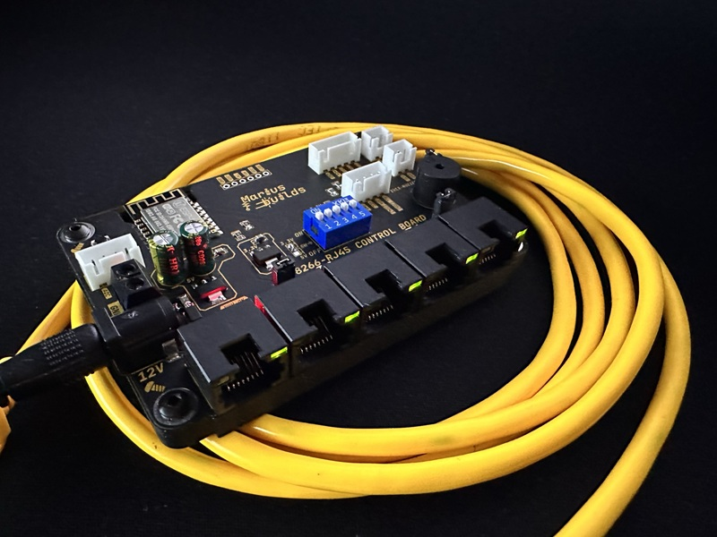

## License 

[](https://creativecommons.org/licenses/by-sa/4.0/)

This project is licensed under [Creative Commons Attribution-ShareAlike 4.0 International](https://creativecommons.org/licenses/by-sa/4.0/).

- ✅ **Share** – copy and redistribute it in any medium or format
- ✅ **Adapt** – remix, transform, and build upon it
- 🏷️ **Attribution** – give credit and link back here
- 🔁 **ShareAlike** – if you remix it, share your version under the same license

## Donate ☕

If you'd like to say thanks or buy me a coffee, a **[PayPal donation](https://www.paypal.com/donate/?hosted_button_id=KHR7DYJP2Z8QJ)** is always appreciated!

Have fun and enjoy it ! 😊
